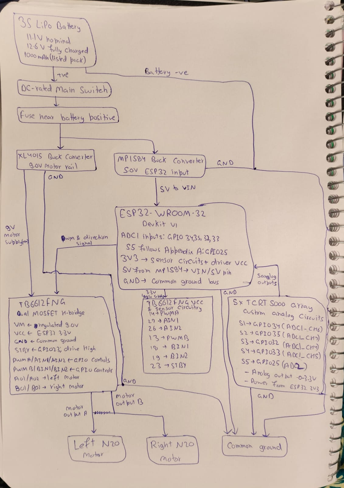

# Task 6 — Electronics & Hardware: Wiring

The wiring diagram is the same hand-drawn diagram as the Task 4 power-block diagram.

## Supply voltages

| Rail | Source | Feeds |
|---|---|---|
| 11.1 V nominal (12.6 V full) | 3S LiPo, 1000 mAh, through the DC-rated main switch and a fuse near battery positive | XL4015 and MP1584 buck converters |
| 9.0 V | XL4015 buck converter | TB6612FNG motor supply (VM) |
| 5.0 V | MP1584 buck converter | ESP32 DevKit V1 VIN / 5V pin |
| 3.3 V | ESP32 3V3 pin | TB6612FNG logic (VCC) and the TCRT5000 sensor circuits |

## Pin connections

| ESP32 GPIO | Connects to | Signal |
|---|---|---|
| 14 | TB6612FNG PWMA | Left motor speed (PWM) |
| 27 | TB6612FNG AIN1 | Left motor direction |
| 26 | TB6612FNG AIN2 | Left motor direction |
| 13 | TB6612FNG PWMB | Right motor speed (PWM) |
| 12 | TB6612FNG BIN1 | Right motor direction |
| 19 | TB6612FNG BIN2 | Right motor direction |
| 23 | TB6612FNG STBY | Driver enable, driven HIGH |
| 34 | TCRT5000 S1 (leftmost) | Analog, ADC1_CH6 |
| 35 | TCRT5000 S2 | Analog, ADC1_CH7 |
| 32 | TCRT5000 S3 (centre) | Analog, ADC1_CH4 |
| 33 | TCRT5000 S4 | Analog, ADC1_CH5 |
| 25 | TCRT5000 S5 (rightmost) | Analog, ADC2 (follows Appendix A) |

The sensor outputs are 0–3.3 V analog signals, powered from the ESP32's 3V3 pin. TB6612FNG outputs AO1/AO2 drive the left N20 motor and BO1/BO2 the right one.

## Common ground

Battery negative, both buck converters, the ESP32, the TB6612FNG and the sensor array all join one common ground bus. Every signal between the boards is measured against this shared ground.

## Role of the motor driver

The TB6612FNG is a dual MOSFET H-bridge. The ESP32 cannot supply motor current, so the driver switches the 9 V motor rail into each motor under the ESP32's 3.3 V control signals: PWM sets the speed, the two direction pins set forward, reverse or brake, and STBY enables the driver.
