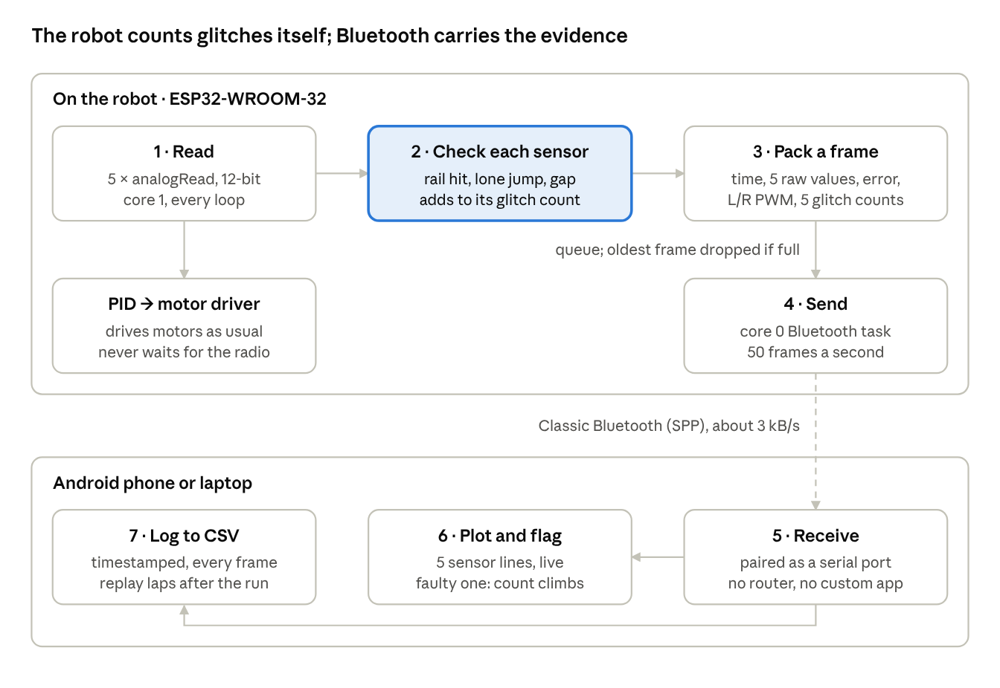

# Task 7 — Wireless Sensor Diagnostics

## In short

- **Protocol: Classic Bluetooth (SPP).** It is the easiest to set up on the ESP32-WROOM-32. Its speed and power are more than enough, and unlike Wi-Fi it does not disturb the ADC that one IR sensor uses.
- **How a faulty sensor is found:** the robot checks every reading itself. A bump moves all five sensors together; a faulty sensor jumps on its own. Each sensor gets a running glitch count.
- **What you see:** an Android phone or laptop shows the five readings live, plus the glitch counts. The faulty sensor is the one whose count keeps climbing. Every frame is also saved to a CSV log.

## Protocol choice

**Classic Bluetooth with the Serial Port Profile (SPP) wins on ease of implementation.** Latency and power are good enough on all three, so they do not decide it.

|  | Wi-Fi | Classic Bluetooth (SPP) | BLE |
|---|---|---|---|
| Latency | Lowest on a good network | Fast enough for a live plot | Data moves only at connection events, every 7.5 ms to 4 s, set by the phone |
| Peak current ([Espressif figures](https://mischianti.org/2021/03/06/esp32-practical-power-saving-manage-wifi-and-cpu-1)) | 240 mA transmitting | 130 mA transmitting | 130 mA transmitting; lowest on average because it sleeps between events |
| Runtime if transmitting non-stop (Task 5: 107 min with radio off) | ~89 min | ~100 min | ~100 min or more |
| Ease on ESP32 + Arduino | Needs a network (phone hotspot or ESP32 access point), IP addresses, and a web page or UDP receiver | `BluetoothSerial` comes with the ESP32 Arduino core and works like Serial. Pair once and it appears as a serial port | Must design a GATT service and characteristic, split data into 20-byte notifications (23-byte default MTU), and decode it in nRF Connect or a custom app |
| Phones | Any | Android and laptops, not iPhone | Any, including iPhone |
| Side effect on the sensors | Stops ADC2 working, so IR_S5 on GPIO 25 fails | None; ADC2 works alongside Bluetooth | None |

### Why Classic Bluetooth, in plain words

- **Ease decides it.** Appendix A already asks for a telemetry line every loop on USB serial. With SPP the same line goes to `SerialBT` instead of `Serial`. There is no app to write and no network to set up.
- **Latency is enough.** The robot catches one-sample glitches on board and sends running counts, so a frame that arrives a little late loses nothing.
- **Bandwidth is tiny.** One text frame is about 64 bytes. At 50 frames a second that is 3.2 kB/s, or 26 kbit/s, under 3% of Classic Bluetooth's 1 Mbit/s basic rate.
- **Power does not matter here.** Runtime drops only from 107 to about 100 minutes.
- **Wi-Fi would fake the fault.** Wi-Fi stops ADC2 working, and IR_S5 (GPIO 25) is on ADC2. Sensor 5 would look faulty, which is exactly the symptom being hunted.
- **The hardware already supports it.** Task 4 picked the WROOM-32 partly for Classic Bluetooth; newer ESP32-S3 and C3 chips offer only BLE.

## Spotting a faulty sensor

**A bump moves all five sensors together; a faulty sensor jumps alone.** When the chassis rocks over a bump, the whole sensor bar changes height, so every reading shifts at once. A loose wire or cracked solder joint affects only its own sensor.

| What you see | Bump | Faulty sensor |
|---|---|---|
| Which sensors change | All five, in the same direction | One, on its own |
| How far | A moderate shift; readings stay inside the calibrated range | Often jumps to 0 or 4095 (open or shorted connection) |
| When | The same spot on the track every lap | At random, even on smooth floor |
| After subtracting the group's average change | Mostly cancels out | Stays large |

**Checks the robot runs on every reading.** Each failed check adds 1 to that sensor's glitch count.

1. **Rail hit:** the reading is near 0 or 4095, far outside its calibrated min–max.
2. **Lone jump:** its change since the last loop differs from the average change of all five by more than a set share of its calibrated range. Start at 25% and tune.
3. **Gap:** it disagrees with both neighbours while they agree with each other, e.g. S2 sees no line while S1 and S3 both do. A continuous line cannot cover S1 and S3 without covering S2. Edge sensors S1 and S5 have only one neighbour, so this check is weaker for them.

Tune the thresholds on a run where all sensors are known to be good: healthy sensors should stay near zero even over bumps. A faulty sensor then stands out by its rising count.

## System architecture

*Diagnostic data flow · robot to phone or laptop, 7 stages*

The control loop on core 1 reads, checks and packs each frame, then hands it to a queue and carries on driving. Core 0, where the Bluetooth stack runs, sends the frames. The phone or laptop plots the five readings and glitch counts live and saves every frame to CSV, so laps can be replayed later.

## Limits and notes

- **Practice runs only.** The rules ban laptops near the arena, require other Wi-Fi and Bluetooth devices to be off, and lock the code once the bot is deposited. So a compile-time switch turns Bluetooth fully off in the competition build, decided before deposit.
- **No iPhone.** SPP is not in [Apple's list of supported Bluetooth profiles](https://support.apple.com/HT204387), so use an Android phone or a laptop.
- **Pin note:** Appendix A labels GPIO 25 as ADC1_CH8, but on the ESP32 it is [ADC2_CH8](https://docs.espressif.com/projects/esp-idf/en/stable/api-reference/peripherals/gpio.html). Bluetooth is fine with ADC2. Still, moving IR_S5 to GPIO 36 or 39 (ADC1, input-only, marked VP and VN on the DevKit) removes the risk if Wi-Fi is ever switched on.
