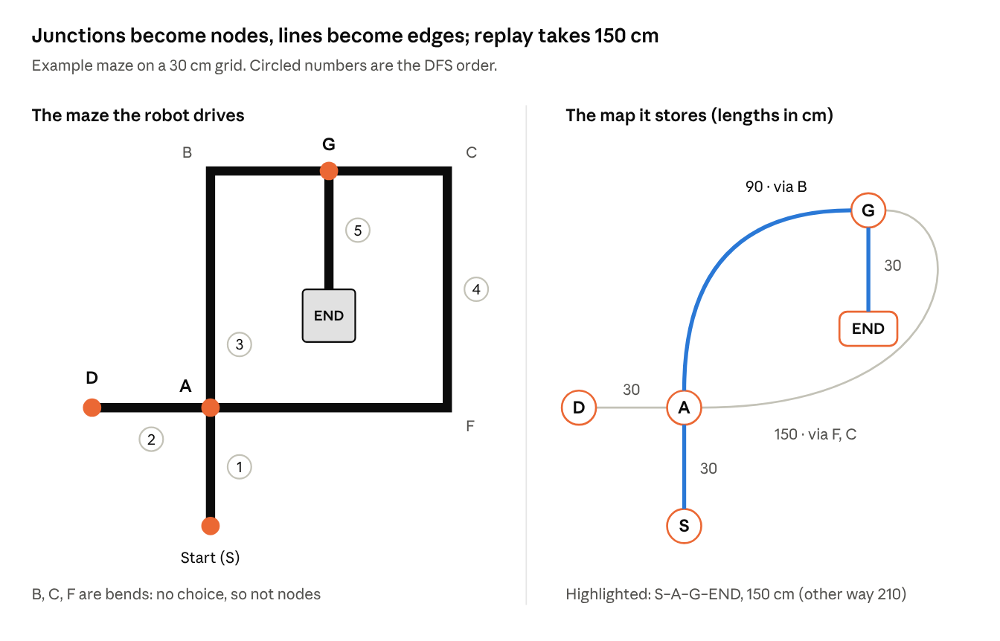

# Task 8 — Maze-Solving Algorithms

## In short

- **Choice: depth-first search (DFS) with a memory of junctions**, trying left first at each junction. Think of it as the left-hand rule plus a memory.
- **Why:** the left-hand rule can circle forever when a loop surrounds the END, and the sample arena already has several loops. DFS remembers where it has been, so it never circles, and it builds a map with distances.
- **Actual run:** the shortest route is worked out from that map before the run. The robot then just follows a short list of turns, one per junction.

## DFS vs the left-hand rule

**For an unknown maze I use DFS: it always finishes, and it leaves a map for the shortest-path run.**

|  | Left-hand rule | DFS with junction memory |
|---|---|---|
| Rule at each junction | Left if possible, else straight, else right, else U-turn | Same left-first order, but only among exits not yet tried |
| What it remembers | Only the list of turns made | A map: junction positions, exits tried, distance between junctions |
| Loops | Can circle forever if a loop surrounds the END | Spots a junction it has seen before and turns back, so it never circles |
| Guaranteed to reach END? | Only if no loop surrounds the END | Yes, in any connected maze |
| Shortest route for the actual run | Delete dead-ends from the turn list (e.g. Left, U-turn, Left becomes Straight). Correct only when the maze has no loops | Shortest-path search (Dijkstra) on the map. Picks the shorter side of every loop it explored |
| Extra hardware | None beyond junction detection | Wheel encoders and heading tracking to know position |
| Code effort | Very small | More: map, position matching, path search |

### Why DFS here

- The sample arena in the rules already has at least four closed loops (the small squares top-left and on the right), and the real arena will be altered. One loop around the END would trap the left-hand rule.
- The encoder motors are already in the BOM (Task 4), so position tracking costs no extra hardware.
- All turns are 90°, so heading is always exactly North, East, South or West. Position = distance from the encoders along that heading.

## Example maze: junctions to nodes, lines to edges

*Example maze and its map · 5 nodes, 5 edges*

Only places where something happens become nodes: the start, junctions, dead ends and END. Each line between two nodes becomes an edge with its length; bends are just part of an edge. The two A–G edges are the two sides of the loop, and the replay uses the 90 cm one.

## Worked traversal

**DFS reaches END after driving 450 cm, and the route it stores for the actual run is 150 cm.** The robot starts at S facing north. Step numbers match the numbered circles on the diagram; a dash marks a return move.

| Step | At | Robot sees | Robot does | Why |
|---|---|---|---|---|
| 1 | S | Line ahead | Follows it north to A (30 cm) | Start |
| 2 | A, new | Exits west, north, east | Saves A; turns left to D | Left first |
| — | D, new | Line ends | U-turn, back to A (30 cm) | Dead end |
| 3 | A | Untried: north, east | Goes north, round bend B, to G (90 cm) | Left first among untried exits |
| 4 | G, new | Exits east, south | Saves G; no left, so straight on, round bends C and F (150 cm) | Left first |
| — | A again | Position matches saved A | Records a second A–G edge (150 cm). A has nothing left to try, so it drives back to G by the shorter known way, via B (90 cm) | Loop found; never explore the same line twice |
| 5 | G | Untried: south | Turns right (30 cm) | Last untried exit |
| — | END | White box | LED on, stop | Goal reached |

**The left-hand rule on the same maze goes S → A → D → A → G → A → S → A → D → … forever.** It always reaches G heading east, where the END branch is on its right, so it never takes it. The right-hand rule fails the same way, going round the loop the other direction.

## Exploration vs replay

**Replay is simpler because every decision is made before the run starts.**

|  | Dry run: exploration | Actual run: replay |
|---|---|---|
| Knows the maze? | No | Yes, from the stored map |
| At each junction | Reads the exits, checks the map, chooses, records | Does the next turn on the list |
| Memory needed | Map plus current position | A list of turns and the segment lengths |
| Odometry | Essential, to recognise old junctions | Only a sanity check |
| Speed | Careful, so junctions are read reliably | Fast on long segments, brakes before known turns |
| Distance in the example | 450 cm | 150 cm |

In the example, the whole actual run is: straight at the 1st junction, right at the 2nd, stop at the white box. Bends need no instruction because the line follower takes them anyway. A missed junction would put the list out of step, so the robot checks each junction against the stored distance; G should come about 90 cm after A.

## Code

[`src/Task8_MazeSolver/Task8_MazeSolver.ino`](../src/Task8_MazeSolver/Task8_MazeSolver.ino) is the pseudocode as a runnable sketch: DFS exploration, Dijkstra planning and replay, run on a text copy of the example maze above.

## Limits

- **Time:** by my estimate from Fig. 1, the sample arena has about 14 m of line. DFS drives most lines about twice, roughly 29 m, so the 3-minute dry run needs an average of at least 0.16 m/s including junction stops. The motors' no-load top speed at 9 V is about 0.33 m/s (0.44 m/s at 12 V, from Task 4), so it fits with little slack.
- **The dry run ends at the END box.** Branches not explored by then stay unknown, so the replay is the shortest route on the explored map. A shorter route through an unexplored branch would be missed. Exploring more costs dry-run points (1 per second) but can earn checkpoints (25 each); that balance is worth testing.
- **Position matching:** the encoders count well under 1 mm per pulse, so the error comes from wheel slip. Junctions in the sample arena are about 30 cm apart, so matching within ±10 cm tells them apart while absorbing a few percent of slip.
